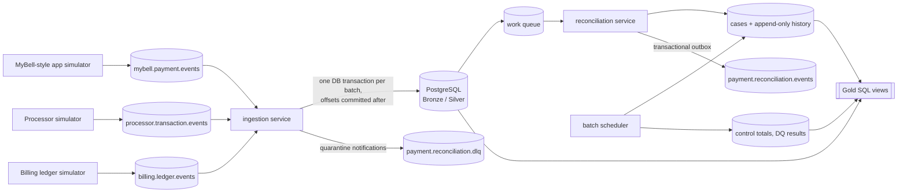

# Bell-Inspired Real-Time Telecom Payment Reconciliation Platform

> **Disclaimer.** This is an independent engineering simulation inspired by publicly described
> telecom bill-payment journeys (such as paying a bill through a MyBell-style self-serve app). It is
> **not** Bell software, is not affiliated with or authorized by Bell, does not reproduce Bell's
> internal architecture, APIs, schemas, volumes or SLAs, and uses **synthetic data only**. It never
> moves money or touches real accounts.

A production-oriented streaming data platform that continuously reconciles three independently
simulated systems - a customer payment application, an external payment processor and a telecom
billing ledger - through Apache Kafka and PostgreSQL, with exact decimal arithmetic, idempotent
ingestion, auditable case management, scheduled business-date reconciliation and SQL reporting.

## Contents
1. [Business context & objectives](#1-business-context--objectives)
2. [Architecture](#2-architecture)
3. [Technology stack](#3-technology-stack)
4. [Quick start](#4-quick-start)
5. [Example event flow](#5-example-event-flow)
6. [Database structure](#6-database-structure)
7. [Kafka topics](#7-kafka-topics)
8. [Reconciliation rules](#8-reconciliation-rules)
9. [Testing](#9-testing)
10. [Sample SQL reports](#10-sample-sql-reports)
11. [Performance testing](#11-performance-testing)
12. [Troubleshooting](#12-troubleshooting)
13. [Security & data limitations](#13-security--data-limitations)
14. [Known limitations](#14-known-limitations)
15. [Future enhancements](#15-future-enhancements)
16. [Repository layout](#16-repository-layout)

## 1. Business context & objectives

When a telecom customer pays a bill, three systems each record part of the story: the app records
the customer's request and the outcome it showed; the payment processor records authorizations,
captures, declines, refunds and reversals; the billing ledger records the credit (and later debits)
on the customer's account. These systems are independent, deliver late, deliver twice, and sometimes
disagree. The platform:

* ingests all three event streams continuously and stores every message durably;
* validates, deduplicates and normalizes them;
* decides per payment whether the sources agree (`MATCHED`, `NO_FINANCIAL_EFFECT`) or why not
  (`AMOUNT_MISMATCH`, `MISSING_BILLING_POSTING`, `DUPLICATE_FINANCIAL_EFFECT`, ...), waiting the
  configured period before declaring a missing counterpart;
* re-evaluates cases when late events arrive and keeps an append-only audit history;
* runs scheduled business-date reconciliation with control totals and data-quality checks;
* exposes Gold reporting views, Prometheus metrics, structured logs and health checks.

## 2. Architecture



Details, sequence diagrams, deployment topology and Kafka design: [docs/architecture.md](docs/architecture.md).
Failure/recovery flow: [docs/failure_recovery.md](docs/failure_recovery.md).

## 3. Technology stack

| Concern | Choice |
|---|---|
| Language | Python 3.12 (containers); the unit-test suite also passes on Python 3.14 on the host |
| Streaming | Apache Kafka 3.9.1 (official `apache/kafka` image, KRaft, no ZooKeeper) via `confluent-kafka` |
| Database | PostgreSQL 17 via `psycopg` 3 + `psycopg-pool` |
| Validation / config | Pydantic 2, pydantic-settings, PyYAML |
| Reliability | tenacity (bounded exponential backoff + jitter) |
| Observability | stdlib JSON logging with redaction, `prometheus-client`; optional Prometheus + Grafana |
| Tests / quality | pytest, pytest-cov, jsonschema, ruff, mypy |
| Packaging | Docker, Docker Compose; pinned `requirements*.lock` |

Nothing paid is required. Spark/Flink/Airflow/Kubernetes are intentionally not used (see architecture doc).

## 4. Quick start

Prerequisites: Docker Desktop (or Docker Engine) with Compose v2, ~4 GB free RAM. Python is only
needed on the host if you want to run unit tests outside Docker.

```bash
# 1. Configuration (placeholders only - change the passwords)
cp .env.example .env                 # PowerShell: Copy-Item .env.example .env

# 2. Build images
docker compose build

# 3. Start infrastructure, create topics and run migrations (idempotent one-shot jobs)
docker compose up -d kafka postgres
docker compose up kafka-init db-init

# 4. Start the whole pipeline (3 simulators, ingestion, reconciliation, batch scheduler)
docker compose up -d
docker compose ps

# 5. Optionally seed a deterministic demo dataset (events dated 2 h ago, so waits have expired)
docker compose run --rm tools python -m scripts.seed_demo_data --payments 500

# 6. Look at the results
docker compose run --rm tools python -m scripts.report daily_summary oldest_unresolved_exceptions
docker compose run --rm tools python -m scripts.report --all
```

| Task | Command |
|---|---|
| Inspect a topic | `docker compose exec kafka /opt/kafka/bin/kafka-console-consumer.sh --bootstrap-server localhost:9092 --topic payment.reconciliation.events --from-beginning --max-messages 5` |
| Query PostgreSQL | `docker compose exec postgres psql -U recon_app -d recon -c "SELECT reconciliation_status, count(*) FROM reconciliation_cases GROUP BY 1"` |
| Daily reconciliation | `docker compose run --rm tools python -m batch.daily_reconciliation [--business-date YYYY-MM-DD]` |
| Historical backfill | `docker compose run --rm tools python -m batch.backfill --start-date 2026-10-20 --end-date 2026-10-27` |
| Consumer lag | `docker compose run --rm tools python -m scripts.report --kafka-lag` |
| Logs | `docker compose logs -f ingestion reconciliation` |
| Metrics | `curl http://localhost:9101/metrics` (ingestion), `:9102` reconciliation, `:9103-9105` producers, `:9106` scheduler |
| Prometheus + Grafana (optional) | `docker compose --profile observability up -d` -> http://localhost:3000 (dashboard "Bell-inspired Payment Reconciliation - Overview") |
| Stop (keep data) | `docker compose down` |
| **Reset - deletes all local data** | `docker compose --profile observability --profile test --profile tools down -v` |

> **Warning:** `down -v` removes the Kafka and PostgreSQL volumes. Use it only for local synthetic data.

The operational runbook ([docs/operational_runbook.md](docs/operational_runbook.md)) covers outages,
quarantine handling, disputed cases, rule-version deployment and more.

### 4.1 Production deployment (single VM)

Target: one Ubuntu 22.04/24.04 VM (e.g. Oracle Cloud Always Free Ampere A1, 4 OCPU / 24 GB). All ports
stay bound to `127.0.0.1`; reach Grafana through an SSH tunnel (`ssh -L 3000:localhost:3000 user@vm`).

**Fully automated (recommended):** [infra/provision.ps1](infra/provision.ps1) creates the network and VM
with Terraform ([infra/oracle/](infra/oracle)), the VM installs Docker and starts the stack on first boot
(cloud-init + [deploy/init_env.sh](deploy/init_env.sh), random database/Grafana passwords generated on the
VM), and the script stores the deploy SSH key, pinned host key and VM address as GitHub environment
secrets and enables the deploy job. One-time prerequisites: an Oracle Cloud account with an API key,
`winget install Hashicorp.Terraform`, `winget install GitHub.cli`, `gh auth login`, and
`infra/oracle/terraform.tfvars` (copy the `.example`). Then:

```powershell
./infra/provision.ps1
```

Terraform state (`infra/oracle/terraform.tfstate`) contains the SMTP password - it is git-ignored; keep it private.

**Manual alternative:**

```bash
# On the VM, once
curl -fsSLO https://raw.githubusercontent.com/<you>/payment-system/main/deploy/bootstrap_vm.sh
bash bootstrap_vm.sh https://github.com/<you>/payment-system.git   # installs Docker, clones, creates .env
nano ~/payment-system/.env     # real passwords, ENVIRONMENT=production, SIM_RUN_ID=prod, SMTP_* + ALERT_EMAIL_TO
bash ~/payment-system/deploy/deploy.sh                            # build, start, wait until healthy
```

[docker-compose.prod.yml](docker-compose.prod.yml) adds on top of the base stack:
Prometheus alert rules ([observability/alerts.yml](observability/alerts.yml)) routed to e-mail through
Alertmanager, host metrics (node-exporter), nightly `pg_dump` backups with retention and a
`BackupStale` alert, and 30-day metric retention. Every container has log rotation.

CI/CD ([.github/workflows/ci.yml](.github/workflows/ci.yml)): ruff, mypy and unit tests, then the full
integration/end-to-end/recovery suite in Docker, then - on `main`, when the repository variable
`DEPLOY_ENABLED=true` - an SSH deploy that runs `deploy/deploy.sh <sha>` on the VM. Required secrets
(environment `production`): `DEPLOY_HOST`, `DEPLOY_USER`, `DEPLOY_SSH_KEY` (a dedicated key) and
`DEPLOY_KNOWN_HOSTS` (output of `ssh-keyscan <vm-ip>`).

Restore a backup: `docker compose exec -T postgres pg_restore -U postgres -d recon --clean < backups/<file>.dump`
(test this once; a backup that was never restored is not a backup). Copy dumps off the VM periodically.

## 5. Example event flow

Payment `PAY-local-000000001234`, CAD 125.40, credit card:

| # | Topic | Event | Effect |
|---|---|---|---|
| 1 | billing.ledger.events | `PAYMENT_CREDIT` 125.40 POSTED (arrives first - out of order) | Bronze + Silver; case created `PENDING_MATCH / AWAITING_APPLICATION_RECORD` |
| 2 | mybell.payment.events | `PAYMENT_INITIATED` 125.40 | Request recorded; `PENDING_MATCH / AWAITING_PROCESSOR_OUTCOME` |
| 3 | processor.transaction.events | `AUTHORIZATION` 125.40 | Not a capture; still pending |
| 4 | processor.transaction.events | `CAPTURE` 125.40 (delivered twice) | Second delivery -> `DUPLICATE_DELIVERY`, no effect |
| 5 | mybell.payment.events | `PAYMENT_SUCCEEDED` | Case `MATCHED / FULL_MATCH`, history row, outbox event |
| 6 | processor.transaction.events | `REFUND` 25.00 -> capture | `REFUND_PENDING` until the ledger debit arrives (or wait expires -> `MISSING_BILLING_POSTING`) |
| 7 | billing.ledger.events | `REFUND_DEBIT` 25.00, `processor_reference` = refund id | `MATCHED / PARTIALLY_REFUNDED`, net 100.40 on both sides |

## 6. Database structure

* **Bronze:** `raw_payment_events` (original bytes, unique Kafka position), `deduplication_keys`, `quarantined_events`.
* **Silver:** `payment_requests`, `application_payment_events`, `processor_transactions`, `payment_refunds`, `payment_reversals`, `billing_ledger_entries`.
* **Reconciliation:** `reconciliation_cases`, `reconciliation_history` (append-only), `reconciliation_rule_versions`, `reconciliation_work_queue`, `reconciliation_outbox`, `admin_actions` (append-only).
* **Batch:** `reconciliation_run_history`, `source_control_totals`, `data_quality_results`.
* **Gold views:** `gold_daily_payment_summary`, `gold_reconciliation_exceptions`, `gold_financial_differences`, `gold_source_completeness`, `gold_processing_latency`, `gold_refund_summary`, `gold_reconciliation_run_summary`.

Migrations: [database/migrations/](database/migrations) (checksum-tracked). Gold: [analytics/gold_tables.sql](analytics/gold_tables.sql).
Full field-level documentation: [docs/data_dictionary.md](docs/data_dictionary.md).

## 7. Kafka topics

| Topic | Type | Key |
|---|---|---|
| `mybell.payment.events` | input | payment_id |
| `processor.transaction.events` | input | payment_id (refunds/reversals use the original payment_id) |
| `billing.ledger.events` | input | payment_id (account_ref for CHARGE) |
| `payment.reconciliation.events` | output | payment_id |
| `payment.reconciliation.dlq` | dead letter | original key; original bytes + `x-error-*` headers |

Local: 1 broker, RF 1, 6 partitions (DLQ 3), 7-day retention (DLQ 30 days). Production guidance in
[docs/architecture.md](docs/architecture.md#3-kafka-design).

## 8. Reconciliation rules

Matching uses only the shared `payment_id` and explicit transaction references - never similar
amounts or times. Amounts are compared with exact `Decimal`. Waiting periods are per payment method
and versioned in [config/reconciliation_rules.yaml](config/reconciliation_rules.yaml) (demo-sized,
not Bell SLAs). Full decision table, status diagram, refund/reversal semantics and metric
definitions: [docs/business_rules.md](docs/business_rules.md).

## 9. Testing

```bash
# Unit tests (no infrastructure) - on the host or in the test image
python -m pytest tests/unit -q
docker compose --profile test run --rm tests pytest tests/unit -q

# Integration, end-to-end and recovery tests (need Kafka + PostgreSQL; each module creates and drops
# its own database and its own uniquely-named topics, so they never touch the demo data)
docker compose --profile test run --rm tests pytest tests/integration -q
docker compose --profile test run --rm tests pytest tests/end_to_end -q
docker compose --profile test run --rm tests pytest tests/recovery -q

# Everything with coverage (HTML report in ./reports/htmlcov)
docker compose --profile test run --rm tests
```

Test results: see [section 9.1](#91-test-results).

### 9.1 Test results

Measured on 2026-10-28 with `docker compose --profile test run --rm --no-deps tests pytest --cov ...`
(Python 3.12.16 container, Kafka 3.9.1, PostgreSQL 17):

| Suite | Tests | Result |
|---|---|---|
| Unit (`tests/unit`) | 112 | passed (also passed on the host with Python 3.14) |
| Integration (`tests/integration`) | 17 | passed |
| End-to-end through Kafka (`tests/end_to_end`) | 16 | passed |
| Recovery / failure injection (`tests/recovery`) | 3 | passed |
| **Total** | **148** | **148 passed in 154.5 s** |

Line+branch coverage: **82 %** (HTML report in `reports/htmlcov`). Static checks: `ruff check .` and
`mypy` on all packages report no issues.

Required scenarios -> tests:

| # | Scenario | Test |
|---|---|---|
| 1-5, 7, 9-11 | matched, processor amount mismatch, missing billing, missing processor, declined, out-of-order, full refund, partial refunds, reversal | `end_to_end/test_pipeline_scenarios.py::test_scenario_status_and_amounts[*]` (status **and** net/billing/difference amounts) |
| 6 | Duplicate delivery (same event re-sent + same capture under new event id) | `test_duplicate_delivery_has_no_duplicate_financial_effect` |
| 8 | Late-arriving counterpart | `test_late_arriving_counterpart_resolves_case_with_audit` |
| 12, 18 | Invalid payload, unsupported schema version | `test_invalid_and_unsupported_events_quarantined_and_dead_lettered` |
| 13 | Database outage | `recovery/...::test_database_outage_does_not_lose_or_duplicate_events` |
| 14 | Consumer restart / crash before offset commit | `recovery/...::test_crash_before_offset_commit_and_restart_is_idempotent` |
| 15 | Failed batch job then safe rerun | `integration/test_batch_and_concurrency.py::test_failed_run_then_safe_rerun` |
| 16 | Repeated reconciliation of a business date | `test_rerun_same_date_is_idempotent` |
| 17 | Concurrent events for the same payment | `test_concurrent_evaluations_of_same_payment_are_serialized` |
| - | Gold totals for a known dataset | `test_gold_reports_match_known_dataset` |

**Important untested or lightly tested paths** (from the coverage report): `batch/scheduler.py` (0 %,
exercised only manually), `generators/publisher.py` and the producer entry points (exercised by the
seed/load-test runs, not by pytest), the `main()`/CLI wiring of the services and admin CLI, the
non-transient per-record DLQ fallback in `IngestionService._fallback_per_record`, the outbox
failure path, and the HTTP health server. Kafka broker outages are covered by a manual drill only.

## 10. Sample SQL reports

All report queries (with numerator/denominator definitions) live in
[analytics/reports.sql](analytics/reports.sql) and run via `python -m scripts.report <name>`:

```sql
-- Oldest unresolved exceptions
SELECT payment_id, reconciliation_status, reason_code, expected_amount, processor_amount,
       billing_amount, difference_amount, age_hours
FROM gold_reconciliation_exceptions ORDER BY exception_created_at LIMIT 25;

-- Matched vs unmatched per business date
SELECT business_date, matched_payments, matched_net_amount, unmatched_payments, unmatched_amount
FROM gold_daily_payment_summary ORDER BY business_date DESC;

-- Amount mismatches by failing comparison
SELECT business_date, comparison, reason_code, case_count, absolute_difference_amount
FROM gold_financial_differences WHERE reconciliation_status = 'AMOUNT_MISMATCH';
```

## 11. Performance testing

```bash
docker compose stop mybell-producer processor-producer billing-producer   # isolate load-test traffic
docker compose run --rm tools python -m scripts.run_load_test --payments 20000 --rate 300 --burst-rate 1500 --burst-seconds 10
```
Method, hardware and **measured** results: [docs/performance_testing.md](docs/performance_testing.md).

Summary of what I measured on a shared, CPU-contended laptop (i5-1245U, Docker Desktop):

* At **35 events/s** for 5 minutes (the 3M/day average): ingestion kept pace. Kafka-to-Bronze p50/p95 was 1.1 s / 2.5 s,
  max lag 191, and last-event-to-case p95 was 1.9 s.
* At 100 events/s with a 300 events/s burst: ingestion topped out at about 39 events/s. Lag peaked at 11,274 and
  drained with no loss or duplication. The bottleneck is per-record PostgreSQL round trips in the ingestion
  transaction.
* None of this is a 24-hour soak test or a production capacity claim.

## 12. Troubleshooting

| Problem | Fix |
|---|---|
| `DB_PASSWORD must be set in .env` | `cp .env.example .env` |
| `ingestion` unhealthy | `docker compose logs ingestion`; DB/Kafka reachable? `/readyz` returns the reason |
| No cases appear | Check `reconciliation` logs and `recon_work_queue_depth`; seed data with `scripts.seed_demo_data` |
| Everything `PENDING_MATCH` | Waits have not expired yet (minutes, see rules file); the sweeper re-evaluates automatically |
| `rule_version ... registered with different content` | You edited the rules file without bumping `rule_version` |
| `migration ... was modified after being applied` | Never edit applied migrations; add a new one |
| Port already in use | Change host port mappings in `docker-compose.yml` (bound to 127.0.0.1) |
| Docker build fails with `frontend grpc server closed` | Retry the build (BuildKit transient) |
| Ingestion stalls; logs show `Consumer group session timed out` / `GroupCoordinator: Timed out` | Broker CPU-starved and fenced by its own controller; free host CPU, `docker compose restart kafka`. Details: [docs/failure_recovery.md](docs/failure_recovery.md) section 2.1 |

## 13. Security & data limitations

Synthetic data only; no card data; secrets only in a git-ignored `.env`; least-privilege DB roles with
column-level grants; append-only audit tables; audited admin CLI; redacted JSON logs; non-root,
read-only containers bound to localhost. The local environment is **not** production-secure (Kafka
PLAINTEXT, no TLS to PostgreSQL, env-file secrets). See [docs/security.md](docs/security.md).

## 14. Known limitations

* Local Kafka is a single broker (RF 1); durability guarantees of a multi-broker cluster are not tested.
  Because broker and controller share one CPU-starved JVM on a laptop, the broker can be fenced and the
  consumer group coordinator can move (observed once; mitigated, not eliminated - see failure_recovery.md 2.1).
* Delivery is at-least-once with idempotent DB effects, not distributed exactly-once.
* Gold layer is views (always fresh); very large histories would need materialized/partitioned tables.
* Each evaluation reloads the payment's full Silver snapshot - simple and order-independent, but more
  queries per event than incremental state.
* Admin authorization is an environment allow-list (no SSO/IAM).
* No automated database retention/purge (Kafka retention only); no schema registry (JSON + Pydantic contracts).
* Business date of a payment is the initiation date; control totals use each record's own event date,
  so day-boundary timing differences are expected and reported, not reconciled away.
* Waiting periods are demo values, not real business SLAs.
* Performance figures are from one laptop under Docker Desktop and are not representative of production hardware.

## 15. Future enhancements

Schema registry (Avro/Protobuf) with compatibility checks; Kafka TLS/SASL + ACLs; multi-broker
cluster; materialized/partitioned Gold tables refreshed by the batch job; Prometheus alert rules;
CI pipeline (lint, type-check, tests, image scan, SBOM); Bronze archival to object storage; SSO-backed
admin UI with four-eyes approval; settlement-file reconciliation as a fourth source.

## 16. Repository layout

```
admin/          audited admin CLI
analytics/      gold_tables.sql (views), reports.sql (named report queries)
batch/          daily_reconciliation.py, backfill.py, control_totals.py, scheduler.py
common/         config, logging (redaction), money, Kafka config, errors, signals
config/         reconciliation_rules.yaml (versioned)
database/       migrations/, migrate.py, connection.py, repositories.py
docs/           architecture, data dictionary, business rules, runbook, recovery, security, performance, interview guide
generators/     simulation.py (independent sources), runner.py, *_producer.py, publisher.py
ingestion/      consumer.py, event_writer.py, error_handler.py
observability/  metrics.py, prometheus.yml, grafana/
processing/     models.py, validation.py, normalization.py, deduplication.py, rules.py,
                reconciliation_engine.py, lifecycle.py, case_manager.py, reconciliation_service.py
schemas/        JSON Schemas for the three source contracts
scripts/        create_topics, initialize_database, seed_demo_data, run_load_test, report, lock_dependencies
tests/          unit/, integration/, end_to_end/, recovery/
```

`database/schema.sql` from the suggested layout is intentionally replaced by the ordered migrations
(the single source of truth for the schema).
