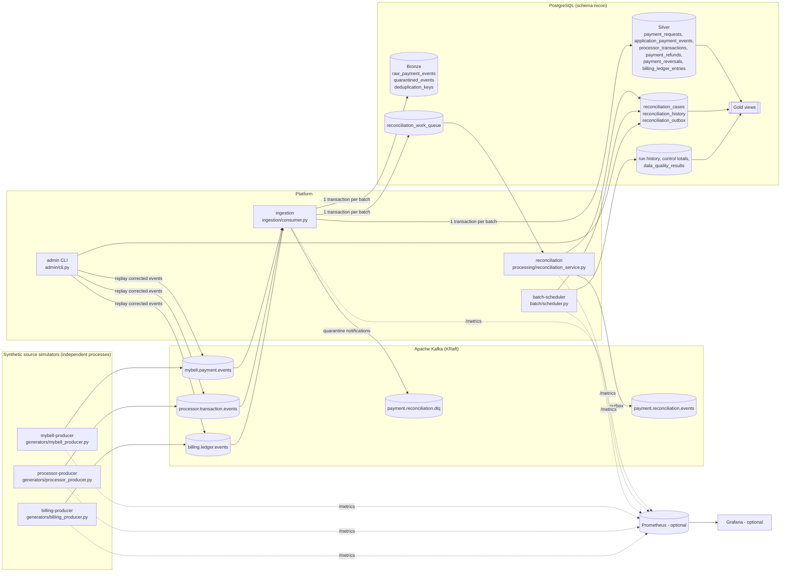
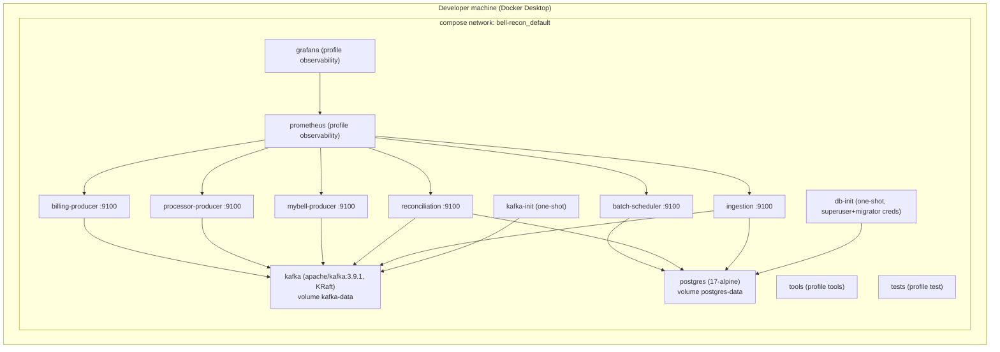

# Architecture

> Independent engineering simulation inspired by public descriptions of telecom bill payment. It is
> **not** Bell software, does not reproduce Bell's internal architecture, and uses synthetic data only.

## 1. System architecture



### Components and why they exist

| Component | Responsibility | Justification |
|---|---|---|
| 3 producers | Simulate independent sources; deterministic seeds; fault injection | Required inputs; independent processes model real independence |
| Kafka | Durable, replayable, partitioned event log | Required; decouples sources from processing; replay window |
| ingestion | Decode, validate, persist Bronze, quarantine, deduplicate, normalize to Silver, enqueue work | Single writer of raw/normalized data with one transaction per batch |
| reconciliation | Evaluate cases from Silver; timeouts; publish case changes | Separate from ingestion so evaluation can scale and be retried independently |
| batch-scheduler | Business-date runs, control totals, DQ checks, backfills | Required complement to streaming; idempotent |
| PostgreSQL | Bronze/Silver/cases/audit/Gold | Required; transactions + constraints enforce correctness |
| Prometheus/Grafana | Metrics/dashboards | **Optional** profile; core pipeline does not depend on them |

No Spark/Flink/Airflow/Kubernetes: the throughput target (3 M events/day ~= 35 events/s) is far
below what a single PostgreSQL instance and one consumer handle, and those tools would add
operational cost without improving correctness.

## 2. Event lifecycle

```mermaid
sequenceDiagram
    participant K as Kafka topic
    participant I as ingestion
    participant DB as PostgreSQL
    participant W as reconciliation worker
    participant O as payment.reconciliation.events
    K->>I: batch of records (payment_id key)
    I->>DB: BEGIN
    loop each record (SAVEPOINT)
        I->>DB: INSERT raw_payment_events ON CONFLICT(topic,partition,offset) DO NOTHING
        alt invalid
            I->>DB: raw status QUARANTINED + quarantined_events
        else valid
            I->>DB: dedup EVENT_ID / BUSINESS_KEY
            I->>DB: INSERT Silver row(s), upsert payment_requests
        end
    end
    I->>DB: upsert reconciliation_work_queue (sorted payment_ids)
    I->>DB: COMMIT
    I->>K: publish DLQ notifications (quarantined only)
    I->>K: commit offsets (sync)
    W->>DB: BEGIN; SELECT queue ... FOR UPDATE SKIP LOCKED
    W->>DB: lock case (INSERT ON CONFLICT DO NOTHING; SELECT FOR UPDATE)
    W->>DB: load full snapshot; evaluate(); UPDATE case; INSERT history + outbox (if material); DELETE queue row
    W->>DB: COMMIT
    W->>O: publish outbox rows; mark published
```

## 3. Kafka design

| Topic | Role | Partitions (local) | Key | Retention |
|---|---|---|---|---|
| mybell.payment.events | input | 6 | payment_id | 7 days |
| processor.transaction.events | input | 6 | payment_id (refunds/reversals carry the **original** payment_id) | 7 days |
| billing.ledger.events | input | 6 | payment_id; `account_ref` for CHARGE entries (not payment-linked) | 7 days |
| payment.reconciliation.events | output (case changes, outbox) | 6 | payment_id | 7 days |
| payment.reconciliation.dlq | dead-letter (original bytes + `x-error-*` headers) | 3 | original key | 30 days |

* **Partitioning decision for refunds/reversals:** keyed by the original `payment_id` (not the refund
  id), so all events of one payment land in the same partition of each topic and are consumed in
  order *within that topic*. Ordering **across** topics/partitions is never assumed - the engine
  recomputes from the full snapshot, so arrival order is irrelevant to the outcome.
* **Producers:** `acks=all`, `enable.idempotence=true`, unlimited retries within `delivery.timeout.ms`, lz4.
* **Consumer:** group `recon-ingestion`, `enable.auto.commit=false`, `enable.auto.offset.store=false`,
  `auto.offset.reset=earliest`, `isolation.level=read_committed`; offsets are committed (asynchronously,
  result reported via `on_commit`) only after the DB transaction commits. A synchronous commit was used
  originally but blocks indefinitely when the group coordinator is unavailable, which stalled the poll loop
  past `max.poll.interval.ms` (see failure_recovery.md 2.1). A lost commit only causes idempotent redelivery.
* **Topics** are created idempotently by `scripts/create_topics.py`; broker auto-creation is disabled.
* **Local vs production:** single KRaft broker, replication factor 1, `min.insync.replicas=1`
  (a single broker cannot hold replicas). Production: >= 3 brokers, RF=3, `min.insync.replicas=2`,
  rack awareness, TLS + SASL, ACLs, and partition counts sized from measured throughput.
* **Lag monitoring:** ingestion exports `recon_consumer_lag_messages{topic,partition}` (high watermark -
  committed offset) every 15 s; `scripts.report --kafka-lag` prints it on demand.

## 4. Delivery guarantee

At-least-once consumption with an idempotent PostgreSQL effect ("effectively once into the
database"); **not** distributed exactly-once. See [failure_recovery.md](failure_recovery.md).

## 5. Concurrency control

* Work queue claims use `FOR UPDATE SKIP LOCKED` -> any number of reconciliation workers.
* One case per payment (`UNIQUE(payment_id)`), created with `INSERT ... ON CONFLICT DO NOTHING`
  and evaluated under `SELECT ... FOR UPDATE`, so the streaming worker, timeout sweeper, batch
  runs and admin actions serialize per payment.
* Ingestion upserts queue rows in sorted `payment_id` order (consistent lock order); deadlocks and
  serialization failures are classified transient and retried.
* Batch runs per business date are mutually exclusive via `pg_try_advisory_lock`.

## 6. Deployment topology (local)



Host port bindings are on `127.0.0.1` only: Kafka 9094, PostgreSQL 5432, service metrics 9101-9106,
Prometheus 9090, Grafana 3000. Startup order is enforced with health checks and
`service_completed_successfully` dependencies on the two init jobs.

## 7. Failure and recovery flow

See the flowchart in [failure_recovery.md](failure_recovery.md#1-delivery-guarantees-what-is-actually-implemented).
