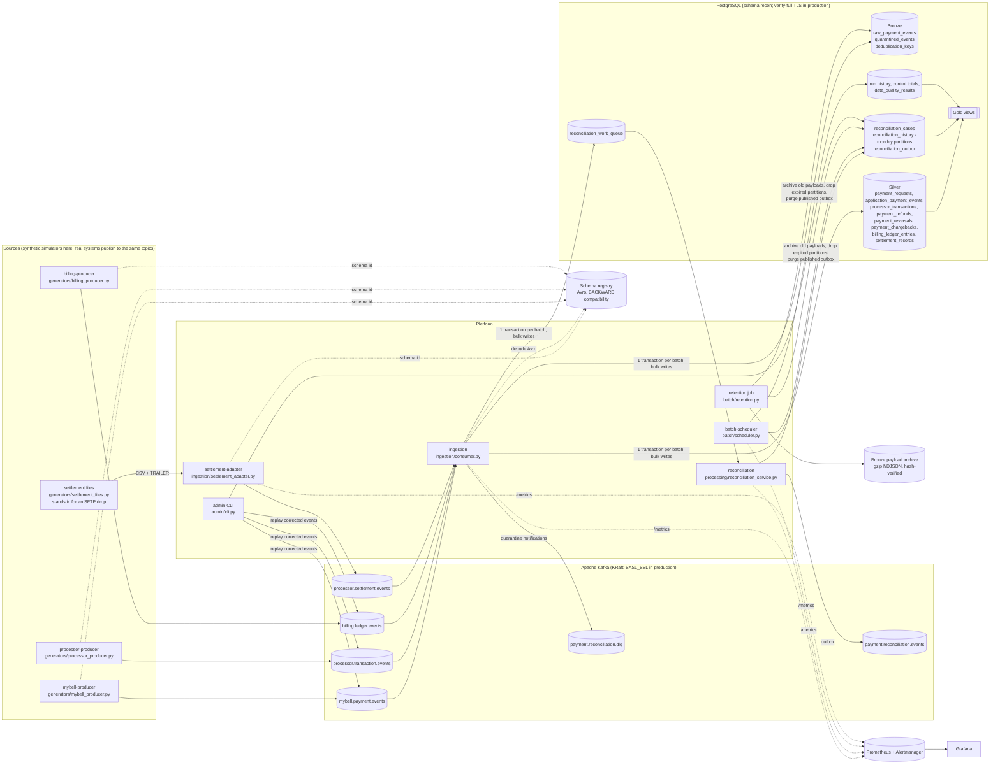
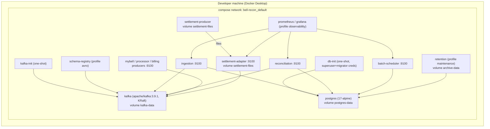
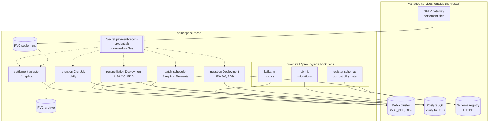
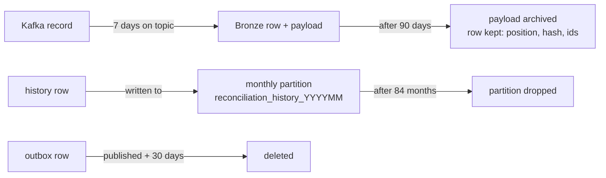

# Architecture

> Independent engineering simulation inspired by public descriptions of telecom bill payment. It is
> **not** Bell software, does not reproduce Bell's internal architecture, and uses synthetic data only.

## 1. System architecture



### Components and why they exist

| Component | Responsibility | Justification |
|---|---|---|
| 3 producers + settlement file generator | Simulate independent sources; deterministic seeds; fault injection | Required inputs; independent processes model real independence. Disabled when real sources are connected |
| settlement-adapter | Parse processor settlement files (header, column count, TRAILER count and total), publish one event per line, move the file to `processed/` or `rejected/` | Settlement arrives as files, not events; converting at the edge keeps one ingestion path |
| Schema registry | Avro schemas per topic; a BACKWARD-compatibility gate runs before every deploy | A source can't ship a breaking change unnoticed. JSON stays accepted side by side |
| Kafka | Durable, replayable, partitioned event log | Decouples sources from processing; replay window |
| ingestion | Decode (JSON or Avro), validate, persist Bronze, quarantine, deduplicate, normalize to Silver, enqueue work | Single writer of raw/normalized data; one transaction per poll batch with set-based writes |
| reconciliation | Evaluate cases from Silver; timeouts; settlement status; publish case changes | Separate from ingestion so evaluation can scale and be retried independently |
| batch-scheduler | Business-date runs, control totals, DQ checks, backfills | Complement to streaming; idempotent |
| retention job | Archive old Bronze payloads, drop expired history partitions, purge published outbox rows | Bounded storage without deleting financial evidence rows |
| PostgreSQL | Bronze/Silver/cases/audit/Gold | Transactions + constraints enforce correctness |
| Prometheus/Alertmanager/Grafana | Metrics, alert rules, dashboards | Core pipeline does not depend on them |

No Spark/Flink/Airflow: the throughput target (3 M events/day ~= 35 events/s) is far below what one
PostgreSQL instance and a few consumers handle. Kubernetes is a deployment target (Helm chart), not a
processing framework: it provides scaling, restarts and secret mounting for the same processes.

## 2. Event lifecycle

```mermaid
sequenceDiagram
    participant K as Kafka topic
    participant I as ingestion
    participant DB as PostgreSQL
    participant W as reconciliation worker
    participant O as payment.reconciliation.events
    K->>I: batch of records (payment_id key; JSON or Avro)
    I->>DB: BEGIN
    I->>I: decode + validate every record (Avro via registry schema id)
    alt bulk path (default, INGESTION_BULK_WRITES)
        I->>DB: SAVEPOINT; executemany Bronze, dedup keys, Silver, quarantine
        Note over I,DB: dedup race with another consumer -> ROLLBACK TO SAVEPOINT, use per-record path
    else per-record path (fallback)
        loop each record (SAVEPOINT)
            I->>DB: INSERT raw_payment_events ON CONFLICT(topic,partition,offset) DO NOTHING
            I->>DB: quarantine, or dedup EVENT_ID / BUSINESS_KEY + Silver row(s)
        end
    end
    I->>DB: upsert reconciliation_work_queue (sorted payment_ids)
    I->>DB: COMMIT
    I->>K: publish DLQ notifications (quarantined only)
    I->>K: commit offsets (async, after DB commit)
    W->>DB: BEGIN; SELECT queue ... FOR UPDATE SKIP LOCKED
    W->>DB: lock case (INSERT ON CONFLICT DO NOTHING; SELECT FOR UPDATE)
    W->>DB: load full snapshot; evaluate(); UPDATE case; INSERT history + outbox (if material); DELETE queue row
    W->>DB: COMMIT
    W->>O: publish outbox rows; mark published
```

## 3. Kafka design

| Topic | Role | Partitions (local) | Key | Retention |
|---|---|---|---|---|
| mybell.payment.events | input | 6 | payment_id | 7 days |
| processor.transaction.events | input | 6 | payment_id (refunds/reversals carry the **original** payment_id) | 7 days |
| billing.ledger.events | input | 6 | payment_id; `account_ref` for CHARGE entries (not payment-linked) | 7 days |
| processor.settlement.events | input (one event per settlement file line, from settlement-adapter) | 6 | payment_id | 7 days |
| payment.reconciliation.events | output (case changes, outbox) | 6 | payment_id | 7 days |
| payment.reconciliation.dlq | dead-letter (original bytes + `x-error-*` headers) | 3 | original key | 30 days |

* **Partitioning decision for refunds/reversals:** keyed by the original `payment_id` (not the refund
  id), so all events of one payment land in the same partition of each topic and are consumed in
  order *within that topic*. Ordering **across** topics/partitions is never assumed - the engine
  recomputes from the full snapshot, so arrival order is irrelevant to the outcome.
* **Producers:** `acks=all`, `enable.idempotence=true`, unlimited retries within `delivery.timeout.ms`, lz4.
* **Consumer:** group `recon-ingestion`, `enable.auto.commit=false`, `enable.auto.offset.store=false`,
  `auto.offset.reset=earliest`, `isolation.level=read_committed`; offsets are committed (asynchronously,
  result reported via `on_commit`) only after the DB transaction commits. A synchronous commit was used
  originally but blocks indefinitely when the group coordinator is unavailable, which stalled the poll loop
  past `max.poll.interval.ms` (see failure_recovery.md 2.1). A lost commit only causes idempotent redelivery.
* **Topics** are created idempotently by `scripts/create_topics.py`; broker auto-creation is disabled.
* **Serialization:** JSON by default; `EVENT_SERIALIZATION=avro` makes producers use the Confluent wire
  format (magic byte + 4-byte schema id + Avro body). Ingestion detects the format per record, so a
  source can migrate without a coordinated cutover. Unknown schema ids and undecodable bodies are
  quarantined (`UNKNOWN_SCHEMA_ID`, `INVALID_AVRO`). Schemas: [schemas/avro](../schemas/avro).
* **Local vs production:** single KRaft broker, replication factor 1, `min.insync.replicas=1`
  (a single broker cannot hold replicas). Production: >= 3 brokers, RF=3, `min.insync.replicas=2`,
  rack awareness, TLS + SASL, ACLs, and partition counts sized from measured throughput.
* **Lag monitoring:** ingestion exports `recon_consumer_lag_messages{topic,partition}` (high watermark -
  committed offset) every 15 s; `scripts.report --kafka-lag` prints it on demand.

## 4. Delivery guarantee

At-least-once consumption with an idempotent PostgreSQL effect ("effectively once into the
database"); **not** distributed exactly-once. See [failure_recovery.md](failure_recovery.md).

## 5. Concurrency control

* Work queue claims use `FOR UPDATE SKIP LOCKED` -> any number of reconciliation workers.
* One case per payment (`UNIQUE(payment_id)`), created with `INSERT ... ON CONFLICT DO NOTHING`
  and evaluated under `SELECT ... FOR UPDATE`, so the streaming worker, timeout sweeper, batch
  runs and admin actions serialize per payment.
* Ingestion upserts queue rows in sorted `payment_id` order (consistent lock order); deadlocks and
  serialization failures are classified transient and retried.
* Batch runs per business date are mutually exclusive via `pg_try_advisory_lock`.

## 6. Deployment topologies

The same image and processes run in every topology; only configuration differs.

| Topology | Where | Used for |
|---|---|---|
| Local Compose | `docker-compose.yml` | Development, demos, the CI integration suite |
| Scheduled production run | `.github/workflows/production-run.yml` | Twice-daily run on GitHub Actions with the database carried between runs (current live environment) |
| Single VM | `docker-compose.prod.yml`, `deploy/`, `infra/azure` | Always-on small deployment with Alertmanager email and nightly backups |
| Kubernetes | `deploy/helm/payment-recon` | Target for a real integration with managed Kafka, PostgreSQL and schema registry |

### 6.1 Local (Compose)



Host port bindings are on `127.0.0.1` only: Kafka 9094, PostgreSQL 5432, schema registry 8081,
service metrics 9101-9107, Prometheus 9090, Grafana 3000. Startup order is enforced with health
checks and `service_completed_successfully` dependencies on the init jobs.

### 6.2 Kubernetes (Helm)



* A failing hook (tampered migration, incompatible schema) stops the rollout before any pod changes.
* Ingestion replicas are capped by topic partitions; extra consumers would sit idle.
* Pods run as uid 10001 with a read-only root filesystem, all capabilities dropped and no service
  account token; a NetworkPolicy allows only DNS, the Kafka/PostgreSQL/registry CIDRs and metrics
  scraping. Only the hook and retention Jobs receive the privileged database passwords.
* CI builds and pushes `ghcr.io/<owner>/payment-system:<sha>` after the integration suite passes;
  deploy by pinning that tag (or its digest).

Operational detail for each topology is in [production.md](production.md).

## 7. Failure and recovery flow

See the flowchart in [failure_recovery.md](failure_recovery.md#1-delivery-guarantees-what-is-actually-implemented).

## 8. Data lifecycle and retention



Bronze rows are never deleted: their Kafka position is the idempotency key and six Silver tables
reference `raw_event_id`. That is also why Bronze is not partitioned (a partitioned table's unique
keys must include the partition column). See [security.md](security.md#3-retention-and-deletion).
