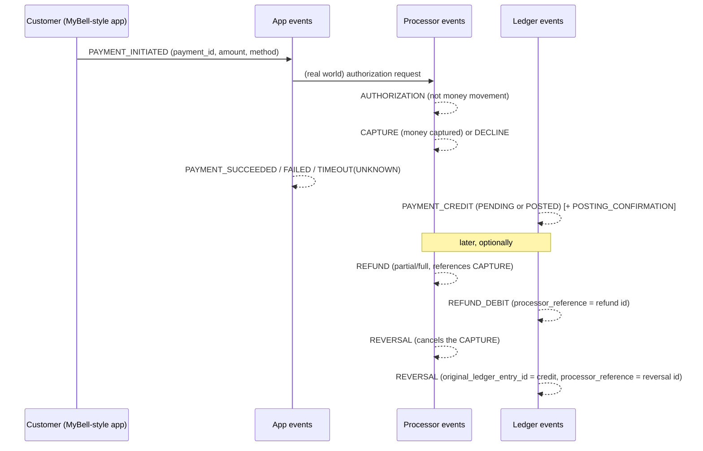
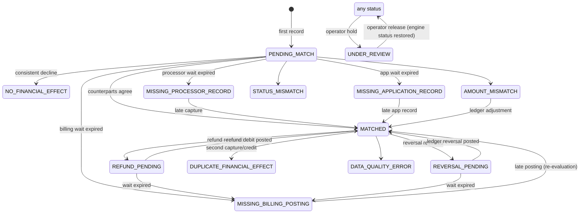

# Business Rules

> Synthetic engineering simulation inspired by publicly described telecom bill-payment journeys.
> It does not reproduce Bell's internal systems, rules, SLAs or volumes. All waiting periods below
> are configurable placeholders in [config/reconciliation_rules.yaml](../config/reconciliation_rules.yaml).

## 1. Identifiers and matching

| Identifier | Owner | Meaning |
|---|---|---|
| `payment_id` | Application | Trusted shared payment reference carried by every source. **The only cross-source matching key.** |
| `processor_transaction_id` | Processor | One per financial transaction (authorization, capture, refund, reversal each distinct). |
| `original_processor_transaction_id` | Processor | Explicit link: capture -> authorization; refund/reversal -> capture. |
| `ledger_entry_id` | Ledger | One per ledger entry. |
| `original_ledger_entry_id` | Ledger | Explicit link: confirmation/reversal/adjustment -> entry. |
| `processor_reference` | Ledger | Explicit link from REFUND_DEBIT / REVERSAL ledger entries to the processor refund / reversal. |
| `event_id` | Every source | Delivery identity (deduplication only, never matching). |

Records are **never** matched because amounts or timestamps look similar.

## 2. Payment lifecycle

The three sources publish independently; any order and any delay is possible.

## 3. Financial model

All amounts are positive magnitudes. Signed effects are derived consistently:

| Quantity | Definition |
|---|---|
| Expected amount | Amount on the first `PAYMENT_INITIATED` (authoritative request) |
| Gross captured | Sum of distinct `CAPTURE` transactions (authorizations are excluded) |
| Total refunded | Sum of distinct `REFUND`s whose original is a capture of this payment |
| Total reversed | First `REVERSAL` per capture; further reversals of the same capture are flagged, not subtracted |
| Net captured | Gross captured - total refunded - total reversed |
| Billing amount (ledger net) | Sum over **effective** ledger entries of the payment: CREDIT +amount, DEBIT -amount |
| Effective ledger entry | `posting_status = POSTED`, or referenced by a `POSTING_CONFIRMATION`; never `REJECTED`. PENDING entries are reported separately as `billing_pending_amount` |
| Difference amount | Observed - expected for the comparison that determined the status (0 when matched) |

**Reversal semantics.** A processor `REVERSAL` cancels a **capture** (e.g. a returned pre-authorized
debit). Reversing an authorization is invalid (`INVALID_REVERSAL_TARGET`); uncaptured authorizations
simply have no financial effect. A ledger `REVERSAL` cancels a ledger entry. Because reversals only
apply to captures already in gross captured, a reversal is subtracted exactly once and never from a
transaction already excluded.

**Refunds** are linked to the original capture and are never treated as new payments. Multiple partial
refunds accumulate; the same refund id (re-delivered) is stored once (Silver primary key). Refunds +
reversals exceeding the capture produce `AMOUNT_MISMATCH / REFUNDS_EXCEED_CAPTURE`.

**No money movement.** The platform never initiates refunds, never posts to accounts and never
contacts real systems; it only observes and reports.

## 4. Reconciliation statuses

Source processing status (e.g. app `FAILED`, processor `CAPTURED`) is stored on Silver rows and
summarized in `app_status` / `processor_outcome`; it is distinct from the reconciliation status.

| Status | Category | Meaning |
|---|---|---|
| PENDING_MATCH | pending | A counterpart is still inside its waiting period |
| REFUND_PENDING | pending | A refund (or its original) awaits its counterpart within the waiting period |
| REVERSAL_PENDING | pending | A reversal awaits its ledger counterpart within the waiting period |
| MATCHED | resolved | All sources agree; amounts equal (exact decimal) |
| NO_FINANCIAL_EFFECT | resolved | *(added)* All sources agree that no money moved (consistent decline, or app failure with no processor activity) |
| AMOUNT_MISMATCH | exception | Amounts disagree |
| STATUS_MISMATCH | exception | Outcomes disagree (e.g. app SUCCEEDED but processor DECLINED) |
| MISSING_PROCESSOR_RECORD | exception | No capture/decline after the processor waiting period |
| MISSING_BILLING_POSTING | exception | No effective ledger posting (or refund/reversal debit) after the waiting period |
| MISSING_APPLICATION_RECORD | exception | Processor/ledger activity with no application record after its waiting period |
| DUPLICATE_FINANCIAL_EFFECT | exception | *(added)* Distinct ids carrying the same economic effect (two captures, two credits, two reversals of one capture) |
| DATA_QUALITY_ERROR | exception | Currency conflict, inconsistent app amounts, invalid or orphan references |
| UNDER_REVIEW | manual | Operator review hold (engine keeps computing `computed_status`) |

### Decision order (rule version 2026.10.1)

The engine ([processing/reconciliation_engine.py](../processing/reconciliation_engine.py)) recomputes the
status from the full snapshot on every evaluation; the first matching rule wins:

1. More than one currency -> `DATA_QUALITY_ERROR / CURRENCY_MISMATCH`; app events disagree with the
   request amount -> `APP_AMOUNT_CONFLICT`; refund/reversal references another payment's transaction
   -> `REFERENCE_PAYMENT_MISMATCH`; refund/reversal targets a non-capture -> `INVALID_*_TARGET`.
2. >1 distinct capture -> `DUPLICATE_CAPTURE`; >1 non-rejected payment credit -> `DUPLICATE_LEDGER_CREDIT`;
   repeated reversal of one capture -> `DUPLICATE_REVERSAL`.
3. No application record: pending until `application_record` wait, then `MISSING_APPLICATION_RECORD`.
4. Capture and decline both present -> `STATUS_MISMATCH / PROCESSOR_CAPTURE_AND_DECLINE`.
5. No capture:
   * decline + effective ledger posting -> `STATUS_MISMATCH / LEDGER_POSTED_FOR_DECLINED_PAYMENT`
   * decline + app SUCCEEDED -> `STATUS_MISMATCH / APP_SUCCEEDED_BUT_PROCESSOR_DECLINED`
   * decline otherwise -> `NO_FINANCIAL_EFFECT / DECLINED_CONSISTENT`
   * within processor wait (per payment method) -> `PENDING_MATCH / AWAITING_PROCESSOR_OUTCOME`
   * app FAILED, no processor or ledger activity -> `NO_FINANCIAL_EFFECT / APP_FAILED_NO_PROCESSOR_ACTIVITY`
   * else `MISSING_PROCESSOR_RECORD` (`CAPTURE_MISSING` if only an authorization exists)
6. Gross captured != expected -> `AMOUNT_MISMATCH / APP_PROCESSOR_AMOUNT_MISMATCH`; app FAILED but captured
   -> `STATUS_MISMATCH / APP_FAILED_BUT_CAPTURED`; refunds + reversals > gross -> `REFUNDS_EXCEED_CAPTURE`.
7. Refund/reversal referencing an unknown transaction: pending until `orphan_reference` wait, then
   `DATA_QUALITY_ERROR / ORPHAN_*_REFERENCE`.
8. No effective payment credit: pending until billing wait (from capture time, per method), then
   `MISSING_BILLING_POSTING / PAYMENT_CREDIT_MISSING` (or `PAYMENT_CREDIT_UNCONFIRMED` if only PENDING).
9. Each refund needs an effective REFUND_DEBIT with `processor_reference` = refund id and equal amount
   (`REFUND_PENDING` -> `REFUND_POSTING_MISSING`, or `REFUND_AMOUNT_MISMATCH`); same for reversals.
10. Ledger net != processor net -> `AMOUNT_MISMATCH / PROCESSOR_LEDGER_AMOUNT_MISMATCH`.
11. Otherwise `MATCHED` with reason `REVERSED`, `FULLY_REFUNDED`, `PARTIALLY_REFUNDED`,
    `MATCHED_WITH_ADJUSTMENT` or `FULL_MATCH`. An ambiguous app result (TIMEOUT/UNKNOWN) resolved by the
    processor is recorded as finding `APP_OUTCOME_RESOLVED_BY_PROCESSOR`.

Every status, reason or amount change appends a row to `reconciliation_history`.

### Lifecycle timestamps

* `exception_created_at` - set when entering an exception status from a non-exception status; kept
  after resolution so the case shows that an exception existed.
* `resolved_at` / `resolution_reason` - set on reaching MATCHED / NO_FINANCIAL_EFFECT
  (`RESOLVED_FROM_<previous>:<reason>` when resolving an exception or review); cleared if the case
  leaves the resolved state.
* `next_evaluation_at` - waiting-period deadline. The timeout sweeper re-queues due cases, so a case
  becomes an exception **only** when its waiting period expires and the counterpart is still missing.

## 5. Waiting periods (rule version 2026.10.1)

| Wait | Starts at | Default | Card | Online banking | PAD |
|---|---|---|---|---|---|
| application_record | earliest event | 300 s | | | |
| processor_outcome | app initiation | 300 s | 180 s | 600 s | 900 s |
| billing_posting | capture event time | 300 s | 240 s | 600 s | 900 s |
| refund_posting / reversal_posting | refund / reversal event time | 600 s | | | |
| orphan_reference | refund / reversal event time | 600 s | | | |

Event time (not ingestion time) is used so historical backfills evaluate deadlines correctly. These
values are demo-sized; real values must come from channel owners. Changing them requires a new
`rule_version`.

## 6. Data quality vs. business exceptions

| Malformed data (quarantined at ingestion) | Legitimate business exception (reconciliation status) |
|---|---|
| invalid JSON / encoding, missing required field | declined payment (`NO_FINANCIAL_EFFECT`) |
| unsupported schema version, unknown field | missing billing posting |
| negative/zero amount, >2 decimals, numeric (non-string) amount | amount mismatch between sources |
| invalid currency code, invalid event type/status combination | duplicate capture with a *different* transaction id |
| timestamp in the future / older than 400 days | late counterpart |
| same event_id or transaction id with different content (conflict) | orphan refund reference (after wait) |

## 7. Metrics

| Metric | Numerator | Denominator | Meaning / caveat |
|---|---|---|---|
| Match rate (excluding pending) | cases MATCHED | cases not pending | High match rate is **not** proof all records are correct |
| Decline rate | payments with processor DECLINE and no capture | payments with a processor outcome | |
| Duplicate rate | raw events DUPLICATE_DELIVERY + DUPLICATE_BUSINESS_EVENT | raw events | by source |
| Quarantine rate | raw QUARANTINED | raw events | by ingestion day |
| Late-arrival rate | valid raw events with ingestion_time - event_time > threshold (60 s) | valid raw events | |
| Application completeness | cases with an app record | all cases | |
| Processor completeness | app cases with capture or decline | app cases excluding `APP_FAILED_NO_PROCESSOR_ACTIVITY` | |
| Ledger completeness | captured cases with any ledger record | captured cases | |
| Open exception rate | cases in exception/review | cases for the business date | |
| Unmatched amount | sum of expected (or captured) amount of exception cases | | |

Gold aggregates use the **one case per payment** grain, so multiple processor events for a payment are
never double-counted.

## 8. Control totals (batch)

`source_control_totals` stores per business date and source: PAYMENT_REQUESTS, APP_EVENTS,
APP_REPORTED_SUCCEEDED, AUTHORIZATIONS, CAPTURES, DECLINES, REFUNDS, REVERSALS,
PAYMENT_CREDITS_EFFECTIVE, PAYMENT_CREDITS_PENDING, REFUND_DEBITS, REVERSAL_DEBITS, ADJUSTMENTS_NET,
CHARGES and Bronze RAW_<status> counts. These figures are **not interchangeable**: requests are intent,
authorizations are holds, captures are money moved, ledger credits are account postings. Comparisons
in the run summary explain expected differences (declines, pending postings, day-boundary timing).
Business dates are derived from UTC event times in `BUSINESS_TIMEZONE` (DST-aware: 23/25 h days).
