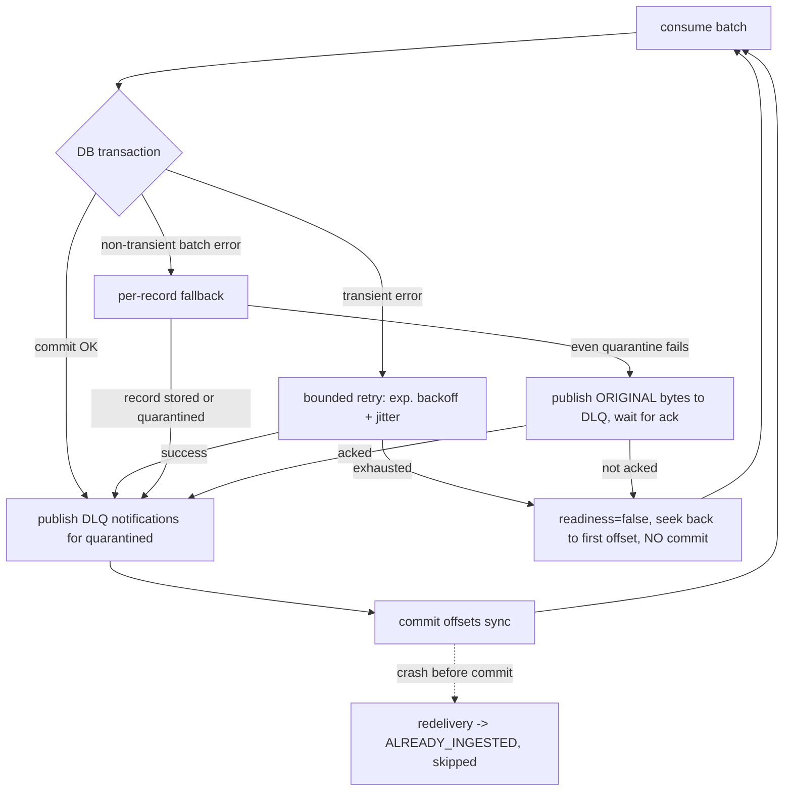

# Failure Recovery and Replay

## 1. Delivery guarantees (what is actually implemented)

| Hop | Guarantee | Mechanism |
|---|---|---|
| Simulator -> Kafka | At-least-once, no producer-retry duplicates | `acks=all`, `enable.idempotence=true` |
| Kafka -> PostgreSQL (ingestion) | At-least-once delivery, **idempotent effect** | Manual offset commit *after* the DB transaction commits; unique `(topic, partition, offset)` in Bronze; EVENT_ID and BUSINESS_KEY dedup keys |
| Silver -> case evaluation | Exactly one case per payment; serialized evaluations | Work queue in the same transaction as Silver writes; `FOR UPDATE SKIP LOCKED`; case row lock |
| Case changes -> `payment.reconciliation.events` | At-least-once | Transactional outbox; consumers must dedupe on `event_id` |

This is **not** distributed exactly-once: Kafka offsets and PostgreSQL commits are not atomic. The
window between DB commit and offset commit can cause redelivery, which is absorbed idempotently
(records are recognised as `ALREADY_INGESTED`).



## 2. Failure scenarios

| Failure | Behaviour | Verified by |
|---|---|---|
| PostgreSQL down / connection killed | Batch rolled back; bounded retries; then rewind via `seek`, offsets not committed, `/readyz` = 503. Resumes automatically. | `tests/recovery/test_failure_recovery.py::test_database_outage_does_not_lose_or_duplicate_events` (database made unavailable with `ALLOW_CONNECTIONS false` + backend termination); `tests/unit/test_consumer_offsets.py` |
| Consumer crash after DB commit, before offset commit | New consumer re-reads; Bronze unique offset -> skipped | `test_crash_before_offset_commit_and_restart_is_idempotent` |
| Kafka broker unavailable | librdkafka reconnects; producers buffer (`delivery.timeout.ms=120s`) and report failed deliveries in metrics | Manual drill (runbook) |
| Invalid / poison message | Quarantined in the same transaction (raw bytes preserved), DLQ notification, offset committed | e2e invalid/unsupported scenarios |
| Quarantine write itself fails (non-transient) | Original bytes published to the DLQ topic and acknowledged before the offset is committed; if the DLQ is unavailable nothing is committed | `IngestionService._fallback_per_record` (unit-tested DLQ ack handling) |
| Reconciliation worker crash | Queue rows were locked in an uncommitted transaction -> lock released, items re-claimed | Transaction semantics; `test_concurrent_evaluations_of_same_payment_are_serialized` |
| Evaluation bug for one payment | Item marked with `attempts`, `last_error`, exponential backoff (max 1 h); other items continue | `ReconciliationWorker._mark_failed` |
| Batch job fails mid-run | Run row marked FAILED with error; evaluation chunks already committed are idempotent; control totals are replaced atomically only on success; rerun is safe | `test_failed_run_then_safe_rerun` |
| Two batch runs for one date | Second run refused (`pg_try_advisory_lock`) | `test_concurrent_run_for_same_date_is_rejected` |
| Outbox publish failure | Rows stay unpublished; retried next loop | `publish_outbox_once` |

### 2.1 Observed incident: group coordinator churn on the local broker

Observed during the live demo on the shared development laptop (not reproduced in CI):

- Symptom: ingestion stopped advancing; librdkafka logged `Consumer group session timed out ... revoking assignment` and
  `GroupCoordinator: Timed out ... out-queue`; consumer lag grew.
- Broker evidence: `BrokerLifecycleManager ... heartbeat request ... REQUEST_TIMED_OUT` (request timeout 4500 ms), followed by
  `Resigned as the group coordinator` / `Elected as the group coordinator ... epoch N+1` for every `__consumer_offsets` partition.
- Root cause: the combined broker+controller process was CPU-starved (other workloads on the host, a JVM-based healthcheck every
  10 s, 90 leftover integration-test topics). The broker missed its heartbeat to its own controller within the default
  `broker.session.timeout.ms` (9 s), was fenced, and all partitions — including the offsets topic — briefly lost their leader.
- Why ingestion did not recover on its own: the consumer was blocked inside a **synchronous** `commit()`, which waits without a
  timeout for the coordinator. The poll loop stopped, librdkafka logged `MAXPOLL ... leaving group`, and the commit could then never
  complete - a permanent stall even after the broker recovered. Fixed by committing asynchronously (still only after the DB commit)
  and reporting commit results via `on_commit` / `recon_offset_commits_total{outcome}`. After redeploying, the consumer rejoined
  and drained the backlog.
- No data loss: offsets are committed only after the PostgreSQL commit, so the consumer resumed from the last committed offset and
  any re-read events were skipped by the Bronze `(topic, partition, offset)` uniqueness.
- Mitigations applied in `docker-compose.yml`: `KAFKA_BROKER_SESSION_TIMEOUT_MS=30000`, `KAFKA_BROKER_HEARTBEAT_INTERVAL_MS=3000`,
  `KAFKA_HEAP_OPTS`, `KAFKA_OFFSETS_TOPIC_NUM_PARTITIONS=6` (fresh volumes only) and a TCP healthcheck; the test suite now deletes its
  per-test topics at session end. Production runs dedicated controllers (3 voters) and RF=3, where this failure mode is a single-broker
  artefact rather than a cluster-wide outage.

## 3. Replay strategies

### 3.1 Restart from committed offsets (default)
Restarting `ingestion` resumes from the consumer group's committed offsets. Nothing else is needed.

### 3.2 Reprocess retained Kafka messages
Because Bronze is idempotent on `(topic, partition, offset)` and Silver on event/business keys, a
reset is safe:

```bash
docker compose stop ingestion
docker compose exec kafka /opt/kafka/bin/kafka-consumer-groups.sh --bootstrap-server localhost:9092 \
  --group recon-ingestion --reset-offsets --to-earliest --all-topics --execute
docker compose start ingestion
```
Re-read records are counted in `recon_kafka_redelivered_records_total` and change nothing.
To re-derive Silver from scratch you would replay into a **new** database (Bronze rows are the
evidence and are never deleted by the platform).

### 3.3 Replay quarantined events after correction
```bash
docker compose run --rm tools python -m admin.cli replay-quarantine --quarantine-id 42 \
  --payload-file /app/load_test_results/fixed.json --actor ops.alice --reason "Currency corrected by source"
```
The corrected payload is validated first, then **published to the original source topic** (header
`x-replay-of-quarantine-id`), so all normal validation and deduplication applies. The quarantine row is
marked REPLAYED with actor and reason; `admin_actions` records the action.

### 3.4 Historical backfill
```bash
docker compose run --rm tools python -m batch.backfill --start-date 2026-10-01 --end-date 2026-10-07
```
Each date is an independent idempotent run (see 2). Interrupt and restart at will.

### 3.5 Re-evaluate pending and unmatched cases
* Automatic: the sweeper re-queues cases whose `next_evaluation_at` passed; any new event re-queues its payment.
* Manual (e.g. after deploying a new `rule_version`):
  `python -m admin.cli reevaluate-open --actor ops.alice --reason "Rule version 2026.11.1 deployed"`

### 3.6 Auditable correction of an incorrect outcome
Outcomes are never edited directly. Fix the input (late/corrected event, ledger adjustment, rule
version), then `reprocess-case`. The prior decision remains in `reconciliation_history`
(append-only), and the new entry carries `trigger_type=ADMIN_REPROCESS`, `actor`, `note` and
`run_id` = admin action id. `review_hold` can freeze a disputed case at `UNDER_REVIEW` while the
engine keeps recording `computed_status`.

## 4. Rule version tracking
`reconciliation_rule_versions` stores the SHA-256 of the rule file per version. Services refuse to
start if the same version is registered with different content. Each case and history row records
the `rule_version` that produced it.
