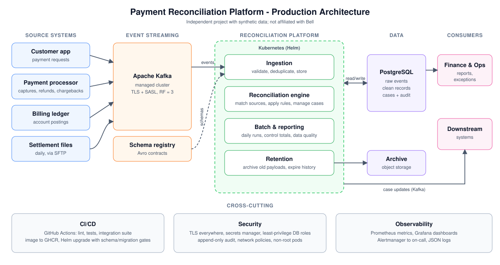

# Production Guide

> Independent engineering project inspired by public descriptions of telecom bill payment. It is **not**
> Bell software and is not connected to any Bell system. The current live environment processes
> synthetic data. This guide describes how the platform runs today and what connecting it to real
> source systems involves.



## 1. Status

| Area | State |
|---|---|
| Live environment | Scheduled production runs on GitHub Actions, twice a day, with the database carried between runs ([production-run.yml](../.github/workflows/production-run.yml)) |
| Data | Synthetic sources (app, processor, billing ledger, settlement files) |
| Integration readiness | Secure transport, file-mounted secrets, Avro + schema registry, settlement files, chargebacks, business-day calendar, retention and a Helm chart are implemented and tested in CI |
| Not done | Deployment to a real Kubernetes cluster; connection to any real source system |

## 2. Environments

| Environment | How it runs | Purpose |
|---|---|---|
| Local | `docker compose up -d` ([README](../README.md#4-quick-start)) | Development and demos |
| CI | [ci.yml](../.github/workflows/ci.yml): lint, types, unit tests, Helm lint, then the integration, end-to-end and recovery suite in Docker; on `main`, the image is pushed to GHCR | Gate for every change |
| Scheduled production | [production-run.yml](../.github/workflows/production-run.yml): 03:30 and 13:30 UTC, or manually with a duration | Current live environment |
| Single VM | [docker-compose.prod.yml](../docker-compose.prod.yml) + [deploy/](../deploy) + [infra/azure](../infra/azure) | Always-on small deployment (Alertmanager email, nightly backups) |
| Kubernetes | [deploy/helm/payment-recon](../deploy/helm/payment-recon) | Target for a real integration |

Architecture diagrams for each topology: [architecture.md](architecture.md#6-deployment-topologies).

## 3. What a real integration needs from other teams

| From | Needed |
|---|---|
| Kafka platform team | Bootstrap servers, SASL/SCRAM or mTLS credentials per service, CA certificate, topics (or create rights), ACLs (section 6) |
| Database team | Managed PostgreSQL 17 with TLS, PITR backups, the four roles (section 5), CA certificate |
| Source system owners (app, processor, billing) | Agreed event contracts (Avro schemas in [schemas/avro](../schemas/avro) are the starting point), topic names, keys (`payment_id`), expected volumes and timing |
| Processor / treasury | Settlement file specification, delivery channel (SFTP), cut-off times, fee rules |
| Finance / business | Waiting periods, tolerances and the holiday calendar in [reconciliation_rules.yaml](../config/reconciliation_rules.yaml) signed off; owners for each exception reason |
| Security | Review of [security.md](security.md), data classification, retention periods, approval to process real data |

## 4. Configuration

All configuration is environment variables (validated at start-up by [common/config.py](../common/config.py)).
Production values that differ from local defaults:

| Variable | Production value | Why |
|---|---|---|
| `ENVIRONMENT` | `production` | Log and metric labelling |
| `REQUIRE_SECURE_TRANSPORT` | `true` | Refuses to start on plaintext Kafka, unverified broker hostnames or `DB_SSLMODE` below `verify-ca` |
| `KAFKA_SECURITY_PROTOCOL` | `SASL_SSL` (or `SSL` for mTLS) | Encrypted, authenticated broker connections |
| `KAFKA_SASL_MECHANISM`, `KAFKA_SASL_USERNAME` | e.g. `SCRAM-SHA-512`, per-service principal | Least privilege per service |
| `KAFKA_SSL_CA_LOCATION` | mounted CA file | Broker certificate verification |
| `DB_SSLMODE`, `DB_SSLROOTCERT` | `verify-full`, mounted CA file | Server identity verification |
| `TOPIC_REPLICATION_FACTOR`, `TOPIC_MIN_INSYNC_REPLICAS` | `3`, `2` | Durability with `acks=all` |
| `EVENT_SERIALIZATION` | `avro` | Schema-checked events |
| `SCHEMA_REGISTRY_URL`, `SCHEMA_REGISTRY_USERNAME`, `SCHEMA_REGISTRY_CA_LOCATION` | registry endpoint and credentials | |
| `SCHEMA_REGISTRY_AUTO_REGISTER` | `false` | Only the deploy-time gate registers schemas |
| `INGESTION_BULK_WRITES` | `true` (default) | Set-based writes per batch |
| `RETENTION_BRONZE_PAYLOAD_DAYS`, `RETENTION_HISTORY_MONTHS`, `RETENTION_OUTBOX_DAYS` | per approved retention policy (defaults 90 / 84 / 30) | |

## 5. Secrets

* No secret is ever in values files, images or the repository.
* Every password can be passed as a file: set `<NAME>_FILE=/path` instead of `<NAME>`. Supported:
  `DB_PASSWORD`, `DB_SUPERUSER_PASSWORD`, `DB_MIGRATOR_PASSWORD`, `DB_REPORTING_PASSWORD`,
  `KAFKA_SASL_PASSWORD`, `KAFKA_SSL_KEY_PASSWORD`, `SCHEMA_REGISTRY_PASSWORD`.
* On Kubernetes, create the Secret `payment-recon-credentials` out of band (External Secrets Operator,
  Vault or sealed-secrets). The chart mounts only the keys each workload needs:

| Secret key | Used by |
|---|---|
| `db-password` | all services (runtime role `recon_app`) |
| `kafka-sasl-password` | all services |
| `schema-registry-password` | all services |
| `db-superuser-password`, `db-migrator-password`, `db-reporting-password` | db-init hook and retention CronJob only |

* CA bundles go in the Secret `payment-recon-ca` (keys `kafka-ca.crt`, `postgres-ca.crt`, `registry-ca.crt`),
  mounted at `/etc/recon/tls`.
* Rotation: update the Secret, then `kubectl rollout restart deploy -l app.kubernetes.io/instance=<release>`.

Database roles (created by db-init): `recon_migrator` (DDL owner), `recon_app` (runtime DML with
column-level grants), `recon_reporting` (read-only). See [security.md](security.md).

## 6. Kafka topics and ACLs

| Topic | Producer principal | Consumer principal |
|---|---|---|
| `mybell.payment.events` | app source system | `recon-ingestion` (group `recon-ingestion`) |
| `processor.transaction.events` | processor source | `recon-ingestion` |
| `billing.ledger.events` | billing source | `recon-ingestion` |
| `processor.settlement.events` | `recon-settlement-adapter` | `recon-ingestion` |
| `payment.reconciliation.events` | `recon-reconciliation` | downstream consumers |
| `payment.reconciliation.dlq` | `recon-ingestion` | operations |

`kafka-init` needs topic create/describe rights only if the platform team does not pre-create topics.
Partition count sets the maximum useful number of ingestion replicas.

## 7. Deploying on Kubernetes

1. **Image.** Every push to `main` that passes CI publishes `ghcr.io/dhikshanandhinis-collab/payment-system:<sha>`.
   Use the SHA (or digest) - never `latest` - in production.
2. **Prerequisites in the namespace:** Secrets `payment-recon-credentials` and `payment-recon-ca`; PVCs
   `payment-recon-settlement` (where the SFTP gateway writes settlement files) and `payment-recon-archive`
   (Bronze archive; back it with immutable object storage).
3. **Values.** Copy [values.yaml](../deploy/helm/payment-recon/values.yaml) and set endpoints, usernames,
   network-policy CIDRs and resources. Keep `simulators.enabled: false` for real sources.
4. **Install or upgrade:**

   ```bash
   helm upgrade --install recon deploy/helm/payment-recon -n recon --create-namespace \
     -f values-prod.yaml --set image.tag=<git-sha> --wait --timeout 15m
   ```

   Before any pod changes, hook Jobs run: `db-init` (migrations, checksum-verified) and `kafka-init`
   (topics), then `register-schemas` (BACKWARD-compatibility gate). If any fails, the
   release stops and the running version is untouched.
5. **Verify:**

   ```bash
   kubectl -n recon get pods,hpa,cronjob
   kubectl -n recon logs deploy/recon-payment-recon-ingestion --tail 50
   kubectl -n recon port-forward deploy/recon-payment-recon-ingestion 9100 &  # then /readyz and /metrics
   ```

6. **Rollback:** `helm rollback recon <revision>`. Migrations are forward-only, so every migration must
   stay compatible with the previous application version (add columns and tables first, remove them in a
   later release). Rolling back the app never rolls back the schema.

### Single VM alternative

`bash deploy/bootstrap_vm.sh` once, `bash deploy/init_env.sh` to generate `.env`, then
`bash deploy/deploy.sh <git-sha>`. CI deploys automatically when the repository variable
`DEPLOY_ENABLED=true` and the VM is running. Details: [README 4.1](../README.md#41-production-deployment-single-vm).

## 8. Cutover from simulators to real sources

1. **Contract test.** Each source publishes sample events to a non-production topic; confirm zero
   quarantines (`python -m scripts.report quarantine_reasons`) and that Avro schemas pass the compatibility gate.
2. **Shadow run.** Run the platform against real topics for at least one full business cycle (including a
   settlement file and a weekend or holiday) with downstream consumers not yet reading
   `payment.reconciliation.events`.
3. **Compare.** Check control totals per source and business date against the source systems' own
   reports, and review every exception reason with the business owners.
4. **Go live** when the go-live checklist (section 11) is complete.
5. **Disable simulators** (`simulators.enabled: false`, and do not deploy the settlement file generator).

## 9. Release process

| Change | Path |
|---|---|
| Code | Pull request, then CI (lint, mypy, unit, Helm lint, integration/e2e/recovery), then the image is pushed to GHCR, then `helm upgrade` with the new SHA |
| Database | New numbered file in `database/migrations/`; never edit an applied migration (db-init rejects changed checksums) |
| Event schema | Edit `schemas/avro/*.avsc` compatibly (new fields need defaults); the pre-upgrade gate rejects breaking changes |
| Reconciliation rules | Bump `rule_version` in `reconciliation_rules.yaml`; every case and history row records the version that produced it. Re-evaluate open cases with the admin CLI if needed ([runbook 3.6](operational_runbook.md)) |

## 10. Operations

### Monitoring and alerts

Services expose `/healthz`, `/readyz` and `/metrics` on port 9100. Alert rules are in
[observability/alerts.yml](../observability/alerts.yml):

| Alert | Meaning | First response |
|---|---|---|
| `ServiceDown` | A service is not being scraped | Check pod or container status and logs |
| `IngestionStalled`, `ConsumerLagHigh` | Events are not being written fast enough | Check Kafka and DB connectivity; scale ingestion (up to the partition count) |
| `OffsetCommitFailures` | Offsets are not committing | Kafka coordinator health; redelivery is safe (idempotent) |
| `IngestionBatchFailures` | Batches are rolling back | Logs for the error; the DB may be unavailable |
| `WorkQueueBacklog`, `ReconciliationItemFailures` | Cases are not being evaluated | Scale reconciliation; check for a failing payment in logs |
| `OutboxBacklog` | Case changes are not being published | Kafka producer health |
| `BatchRunFailed` | Business-date run failed | Re-run with `batch.daily_reconciliation --business-date` |
| `DiskSpaceLow`, `MemoryLow`, `BackupStale` | Host health (VM topology) | |

Day-to-day procedures, drills and quarantine handling: [operational_runbook.md](operational_runbook.md).

### Scaling

* Ingestion: horizontal, up to the number of partitions per topic; each replica writes one transaction per poll batch.
* Reconciliation: horizontal without limit; workers claim queue rows with `FOR UPDATE SKIP LOCKED`.
* Settlement adapter and batch scheduler: one replica each.
* Measured capacity and method: [performance_testing.md](performance_testing.md).

### Retention

The retention job (`python -m batch.retention`, Kubernetes CronJob daily at 04:15 business time) archives
Bronze payloads, drops expired audit-history partitions and purges published outbox rows. Run it with
`--dry-run` first after changing any retention setting. Details: [security.md](security.md#3-retention-and-deletion).

### Backup and recovery

| Topology | Backup | Restore |
|---|---|---|
| Kubernetes (managed PostgreSQL) | Provider PITR backups; Bronze archive on immutable storage | Restore to a point in time; consumers resume from committed offsets and redelivery is idempotent |
| Single VM | Nightly `pg_dump` by the `postgres-backup` service, `BackupStale` alert | `pg_restore` ([README 4.1](../README.md#41-production-deployment-single-vm)) |
| Scheduled runs | Database snapshot cached between runs | Automatic at the start of each run |

If the database is restored to an earlier point, events after that point are re-read from Kafka as long
as they are within topic retention (7 days by default). Recovery behaviour is tested by the recovery
suite: [failure_recovery.md](failure_recovery.md).

## 11. Go-live checklist

- [ ] All source contracts agreed and registered; compatibility gate passing
- [ ] `REQUIRE_SECURE_TRANSPORT=true`; all secrets from the secret manager; no `.env` files
- [ ] Kafka RF=3, `min.insync.replicas=2`, ACLs per section 6
- [ ] PostgreSQL PITR enabled and a restore tested
- [ ] Rules, tolerances, waiting periods and holiday calendar signed off by finance
- [ ] Retention periods approved; archive storage is immutable
- [ ] Alerts routed to an on-call rotation; runbook reviewed with operations
- [ ] Shadow run completed and control totals match the source systems
- [ ] Load test at expected peak volume on production-sized infrastructure
- [ ] Simulators disabled

## 12. Known gaps

* The Helm chart is linted and rendered in CI but has not been deployed to a real cluster.
* Admin authorization is an environment allow-list; production needs SSO and four-eyes approval.
* The Bronze archive writes to a mounted directory; a native object-storage writer is not implemented.
* No image vulnerability scanning or SBOM in CI yet.
* Performance figures come from a laptop and a GitHub runner, not production hardware.
